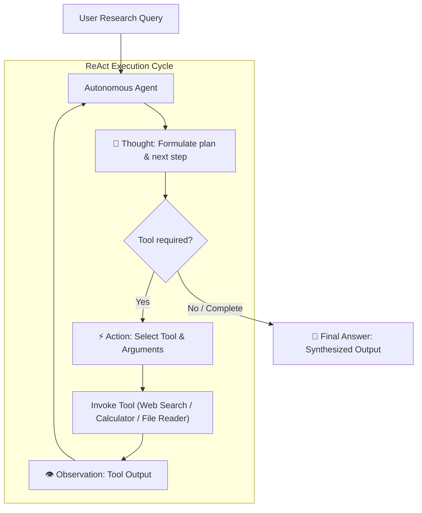

# Multi-Tool Autonomous AI Agent

[](https://www.python.org/)
[](https://www.langchain.com/)
[](https://duckduckgo.com/)
[](https://opensource.org/licenses/MIT)

An autonomous AI console agent capable of dynamically choosing and invoking specialized tools to solve multi-step, compound research queries.

The agent implements a visible **ReAct (Reasoning + Acting)** execution loop:
$$\text{Thought} \longrightarrow \text{Action} \longrightarrow \text{Observation} \longrightarrow \text{Final Answer}$$

---

## 🛠️ Integrated Tools

| Tool | Name | Description | Key Requirement |
| :--- | :--- | :--- | :--- |
| 🔍 **Web Search** | `web_search` | Real-time web search for facts, news, and market data. | Free / No API key (DuckDuckGo) |
| 🧮 **Calculator** | `calculator` | Safe arithmetic and mathematical formula evaluator. | Built-in Python Math Engine |
| 📄 **File Reader** | `read_local_file` | Reads local workspace files (notes, text, reports, data). | Local File System (workspace safe) |

---

## 📐 Architecture & Reasoning Flow



---

## 📁 Project Structure

```text
Multi-tool agent/
├── data/
│   └── company_earnings.txt      # Sample file for testing local file reader
├── src/
│   ├── __init__.py
│   ├── agent.py                  # Autonomous agent ReAct reasoning engine
│   ├── config.py                 # Configuration & multi-provider LLM factory
│   ├── main.py                   # Interactive console interface (CLI)
│   └── tools/
│       ├── __init__.py           # Tools registry & dispatcher
│       ├── calculator.py         # Python math calculator tool
│       ├── file_reader.py        # Local file reader tool
│       └── search.py             # Real-time DuckDuckGo search tool
├── tests/
│   ├── test_tools.py             # Isolated unit tests for all 3 tools
│   └── test_agent_flow.py        # Integration test for compound reasoning loop
├── .env.example                  # Environment configuration template
├── .gitignore                    # Production gitignore
├── requirements.txt              # Pinned Python dependencies
└── README.md                     # Documentation
```

---

## 🚀 Quick Start Guide

### 1. Clone & Navigate to Repository
```bash
git clone https://github.com/Pradeepkaman/Multi-Tool-AI-Agent-.git
cd Multi-Tool-AI-Agent-
```

### 2. Set Up Virtual Environment (Recommended)
```bash
python -m venv .venv
# On Windows (PowerShell):
.venv\Scripts\Activate.ps1
# On Linux / macOS:
source .venv/bin/activate
```

### 3. Install Dependencies
```bash
pip install -r requirements.txt
```

### 4. Configure API Keys
Copy the example environment file and add your API key:
```bash
cp .env.example .env
```
Open `.env` and set your preferred provider:
```ini
LLM_PROVIDER=gemini
GEMINI_API_KEY=your_actual_gemini_api_key_here
GEMINI_MODEL=gemini-2.5-flash
```
*(Alternatively, you can set `OPENAI_API_KEY` or `GROQ_API_KEY`)*

---

## 💻 Usage

### 1. Interactive Console Mode
Launch the interactive REPL:
```bash
python src/main.py
```

Inside the console, you can run research questions or built-in commands:
- `help` — Show available commands
- `tools` — Inspect registered agent tools
- `benchmark` — Run the compound multi-tool test query
- `clear` — Clear the console screen
- `exit` — Exit the agent

### 2. Run Compound Benchmark Directly
To see the agent autonomously chain all 3 tools to solve a complex multi-step question:
```bash
python src/main.py --benchmark
```

### 3. Single-Query Mode (Command Line)
```bash
python src/main.py --query "Search DuckDuckGo for the distance from Earth to Mars and calculate how many hours it takes at 50,000 km/h."
```

### 4. Mock / Offline Mode (No API Key Required)
Run and verify the complete ReAct reasoning loop offline:
```bash
python src/main.py --mock --benchmark
```

---

## 🧪 Testing & Verification

Run standalone unit tests for all tools:
```bash
python tests/test_tools.py
```

Run end-to-end integration test validating the ReAct compound loop:
```bash
python tests/test_agent_flow.py
```

---

## 📄 License
This project is open-source and available under the [MIT License](LICENSE).

